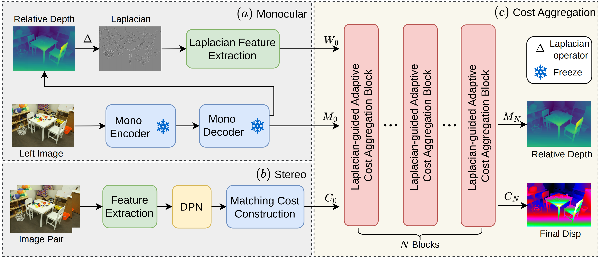
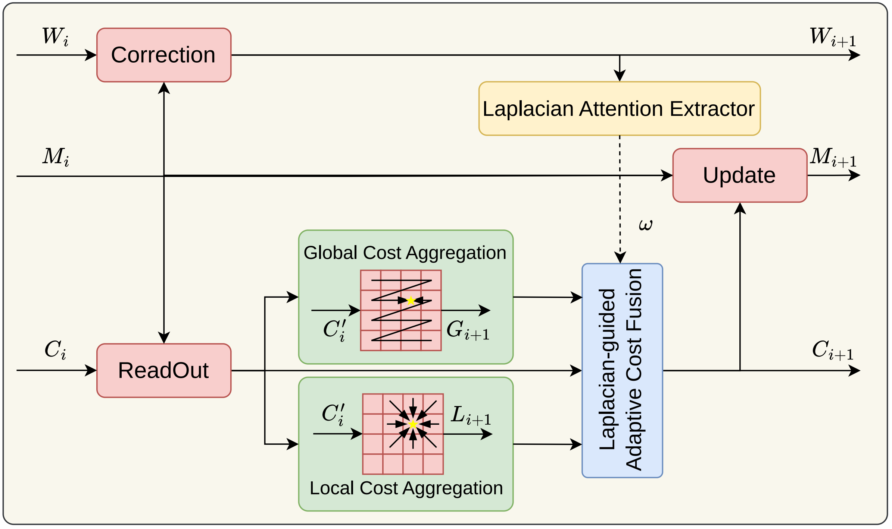

# LACA

## Laplacian-guided Adaptive Cost Aggregation for Stereo Matching

**ACM Multimedia 2026 (MM '26)**

Sen Tai, Rui Cao, Wenting Li, Ziyang Chen, Yang Zhao, Yitong Yang, Yongjun Zhang, and Yong Xu

[**Paper**](https://doi.org/10.1145/3767308.3835685) · [**Weights (Google Drive)**](https://drive.google.com/drive/folders/1LoW-Z7Aj1PjMBokiLEehwRZiE2_y4Z-x) · [**Checkpoints**](#checkpoints) · [**Training**](#training) · [**Evaluation**](#evaluation) · [**Citation**](#citation)

PyTorch implementation of **LACA**, a stereo matching framework that combines global contextual reasoning with local detail preservation through Laplacian-guided adaptive cost aggregation.

## Method

### Motivation

Stereo matching remains challenging in reflective and textureless regions, where local matching evidence is often ambiguous or unreliable. Existing cost aggregation methods mainly rely on local neighborhoods, limiting their ability to propagate reliable disparity cues across distant image regions.

Vision Mamba offers a way to capture long-range dependencies efficiently, but applying it to stereo matching presents two challenges: its scanning strategies are primarily designed for 2D images rather than 4D cost volumes, and its preference for low-frequency information can weaken boundaries and fine details. LACA addresses both challenges by combining global and local cost aggregation with an adaptive fusion mechanism guided by Laplacian features.

### Approach



LACA extracts monocular contextual features and relative depth using a frozen **Depth Anything V2** model. Laplacian features derived from the depth map provide boundary-sensitive guidance. In parallel, the stereo branch uses a Disparity Proposal Network to construct a compact cost volume over selected disparity candidates.

The cost volume is processed by stacked **Laplacian-guided Adaptive Cost Aggregation Blocks**, each combining three components:

- **Global Cost Aggregation (GCA).** We introduce **Disparity-Discontinuous Hybrid Scanning (DDHS)** to adapt Vision Mamba to stereo cost volumes. The resulting 3D Selective Scan captures global contextual dependencies and propagates reliable matching cues into ambiguous regions.
- **Local Cost Aggregation (LCA).** Neural Message Passing aggregates local evidence to preserve boundaries and fine structures, complementing the global branch.
- **Laplacian-guided Adaptive Cost Fusion (LACF).** Corrected Laplacian features predict adaptive fusion weights, balancing the global branch's robustness in ill-posed regions with the local branch's accuracy in detailed regions.



Cross-attention exchanges information between monocular context and stereo features throughout aggregation. A subsequent refinement stage restores fine details and produces the final disparity map.

## Results

Results from Tables 1–3 of the paper. **Lower is better** for all metrics.

### Scene Flow

| Method | EPE (px) | BP-1 (%) |
| --- | ---: | ---: |
| BridgeDepth | 0.37 | 3.67 |
| BridgeDepth-L | 0.32 | 3.25 |
| LACA | 0.34 | 3.36 |
| **LACA-L** | **0.30** | **3.00** |

### KITTI

Results after fine-tuning on mixed KITTI 2012/2015 data.

| Benchmark | Metric | LACA |
| --- | --- | ---: |
| KITTI 2012 Reflective | Out-2 Noc / All (%) | 5.22 / 6.00 |
| KITTI 2012 Reflective | Out-3 Noc / All (%) | 2.64 / 3.03 |
| KITTI 2012 | Out-2 Noc / All (%) | 1.32 / 1.65 |
| KITTI 2012 | Out-3 Noc / All (%) | 0.85 / 1.05 |
| KITTI 2015 | D1 BG / FG / ALL (%) | 1.12 / 2.61 / 1.37 |

### Zero-shot Generalization

Models are trained only on Scene Flow and evaluated on the real-world training sets. Middlebury uses half resolution (H).

| Method | KITTI 2012 BP-3 (%) | KITTI 2015 BP-3 (%) | Middlebury (H) BP-2 (%) | ETH3D BP-1 (%) |
| --- | ---: | ---: | ---: | ---: |
| BridgeDepth | 4.04 | 4.69 | 5.98 | 1.26 |
| **LACA** | **3.79** | **4.43** | **4.99** | **1.13** |

EPE measures mean absolute disparity error. BP-X / Out-X measure the percentage of pixels with an absolute error greater than X pixels. KITTI D1 uses both an absolute threshold of 3 pixels and a relative threshold of 5%. Noc and All denote non-occluded and all evaluated regions, respectively.

## Installation

We recommend **Linux, Python 3.10, and an NVIDIA GPU**. The commands below use PyTorch 2.7.0 with CUDA 12.6; select the appropriate CUDA build for your environment.

```bash
git clone https://github.com/TaiSen-WUhan/LACA.git
cd LACA

conda create -n laca python=3.10
conda activate laca

pip install torch==2.7.0 torchvision==0.22.0 --index-url https://download.pytorch.org/whl/cu126
pip install -r requirements.txt
```

For efficient GPU training and inference, install the optional selective-scan CUDA extension:

```bash
pip install packaging ninja
git clone https://github.com/MzeroMiko/VMamba.git third_party/VMamba
pip install ./third_party/VMamba/kernels/selective_scan --no-build-isolation
```

Building the extension requires a CUDA toolkit with `nvcc` and a compatible compiler. LACA uses VMamba's `selective_scan_cuda_oflex` backend when available and otherwise runs a differentiable PyTorch implementation. The fallback supports CPU execution and functional checks, but is much slower and uses more memory during training; the CUDA extension is recommended for full-resolution workloads. The runtime does not require `mamba-ssm`, Triton, `timm`, or `fvcore`. An xFormers build compatible with PyTorch can optionally accelerate the monocular encoder.

## Checkpoints

Download the pretrained weights from **[Google Drive](https://drive.google.com/drive/folders/1LoW-Z7Aj1PjMBokiLEehwRZiE2_y4Z-x)** and place the `.pth` files in the `weight/` directory at the project root. Keep the filenames listed below so the checkpoint aliases work directly.

| Model | Stereo Encoder | Checkpoint |
| --- | --- | --- |
| LACA | Residual CNN | `laca.pth` |
| LACA-L | ConvNeXt | `l-laca.pth` |
| KITTI model | ConvNeXt | `kitti.pth` |

Weights are hosted on Google Drive and are not included in the Git repository. Each checkpoint includes the model configuration and the pretrained Depth Anything V2-L branch. Use the corresponding checkpoint for Scene Flow evaluation, zero-shot generalization, or KITTI evaluation.

Both entry points and the Python API accept the following aliases or an explicit checkpoint path:

| Alias | Local checkpoint |
| --- | --- |
| `sf` or `laca` | `weight/laca.pth` |
| `l_sf` or `l-laca` | `weight/l-laca.pth` |
| `kitti` | `weight/kitti.pth` |

The saved configuration selects the matching architecture automatically. Loading a full checkpoint requires no additional model downloads.

```python
from LACA.laca import LACA

model = LACA.from_pretrained("sf").cuda().eval()
```

## Datasets

We evaluate on **Scene Flow, KITTI 2012, KITTI 2015, Middlebury, and ETH3D**. See the [dataset preparation guide](LACA/dataloader/README.md) for the expected folders.

The default dataset parent directory is `datasets/` beneath the project root. To use another location, pass `--data-root /path/to/datasets` to either entry point, or set `DATASETS.ROOT` in a YAML configuration. This parent should contain `SceneFlow/`, `KITTI/`, `Middlebury/`, and `ETH3D/` as needed. Dataset paths no longer require source-code edits.

## Training

Run the commands from the project root. The examples use four GPUs; set `--num-gpus 1` for one GPU and adjust `SOLVER.IMS_PER_BATCH` to fit available memory. The batch size is global and must be divisible by the number of GPU processes. Multi-GPU training uses PyTorch DistributedDataParallel; Linux with NCCL is recommended.

### Monocular Pretraining Weights

For training from scratch, download the Depth Anything V2-L weights for initialization:

```bash
python -c "from huggingface_hub import hf_hub_download; hf_hub_download(repo_id='depth-anything/Depth-Anything-V2-Large', filename='depth_anything_v2_vitl.pth', local_dir='checkpoints')"
```

When initialized from scratch, LACA-L also loads torchvision ConvNeXt-Tiny ImageNet weights. These are cached by PyTorch after the first download. A full LACA checkpoint already contains both branches.

### Scene Flow

Train **LACA**:

```bash
python main.py --num-gpus 4 --checkpoint-dir checkpoints/sf
```

Train **LACA-L**:

```bash
python main.py --num-gpus 4 --config-file configs/L_train.yaml --checkpoint-dir checkpoints/l_sf
```

### KITTI Fine-tuning

Fine-tune the Scene Flow-pretrained model on mixed KITTI 2012/2015 data:

```bash
# KITTI
python main.py --num-gpus 4 --config-file configs/kitti_mix_train.yaml --checkpoint-dir checkpoints/kitti SOLVER.RESUME checkpoints/l_sf/step_300000.pth
```

### Resume and Initialization

Resume model, optimizer, iteration, and learning-rate scheduler from the latest checkpoint, using the same experiment configuration and `SOLVER.MAX_ITER`:

```bash
python main.py --num-gpus 4 --checkpoint-dir checkpoints/sf SOLVER.RESUME checkpoints/sf/checkpoint_latest.pth
```

`checkpoint_latest.pth` includes training state. The `step_XXXXXX.pth` files contain model weights and architecture for evaluation or fine-tuning. To start a new schedule from released weights, use `--from-pretrained sf` or `--from-pretrained l_sf`. `SOLVER.NO_RESUME_OPTIMIZER True` also starts a new schedule when loading through `SOLVER.RESUME`; the KITTI configuration enables this setting.

Validation runs every `TEST.EVAL_PERIOD` steps; set it to `0` to disable validation during training. Checkpoints and logs are written to `--checkpoint-dir`.

### Training Settings

| Setting | Value |
| --- | --- |
| Hardware | 4 NVIDIA RTX A6000 GPUs |
| Optimizer / schedule | AdamW / one-cycle learning rate |
| Scene Flow pretraining | 300,000 iterations, batch size 8 |
| Training crop | 384 × 768 |
| Peak learning rate | 5 × 10^-4 |
| KITTI fine-tuning | 40,000 steps |
| Monocular branch | Depth Anything V2-L, frozen |
| Coarse / refinement blocks | 5 / 5 |

These settings are reported in the paper. The bundled defaults use a `[368, 784]` crop, and `configs/kitti_mix_train.yaml` uses 39,000 iterations. For those paper settings, override `DATASETS.CROP_SIZE` with `[384, 768]` and the KITTI `SOLVER.MAX_ITER` with `40000`.

## Evaluation

### Your Own Stereo Images

Predict disparity from a rectified left/right pair:

```bash
python infer.py --from-pretrained sf --input path/to/left.png path/to/right.png --output results/laca
python infer.py --from-pretrained l_sf --input path/to/left.png path/to/right.png --output results/laca_l
```

For multiple pairs, pass two directories or quoted glob patterns:

```bash
python infer.py --from-pretrained sf --input "images/left/*.png" "images/right/*.png" --output results
```

Images are paired in sorted order; both sides must contain the same number of images with matching dimensions. Inputs are padded automatically and predictions are restored to the original image size. Each pair produces a floating-point `.npy` disparity map in pixels and a color `.png` visualization. Use the `.npy` file for quantitative analysis. CUDA is selected automatically when available; `--device cpu` runs the slower CPU fallback.

### KITTI Test Sets

Generate predictions for submission to the KITTI evaluation server:

```bash
python infer.py --dataset-name kitti_2015 --from-pretrained kitti  # produce kitti_2015_submission in current working directory
python infer.py --dataset-name kitti_2012 --from-pretrained kitti  # produce kitti_2012_submission in current working directory
```

The generated predictions are evaluated by the official KITTI server, since test-set ground truth is not publicly available.

### Zero-shot Generalization

Evaluate the Scene Flow-trained model on the real-world benchmarks specified in the evaluation configuration:

```bash
python main.py --num-gpus 4 --eval-only --config-file configs/zero_shot_evaluation.yaml --from-pretrained sf
```

Use Scene Flow-pretrained weights for zero-shot evaluation, without fine-tuning on the target datasets.

## Citation

If you find this work useful, please cite:

> Sen Tai, Rui Cao, Wenting Li, Ziyang Chen, Yang Zhao, Yitong Yang, Yongjun Zhang, and Yong Xu. 2026. Laplacian-guided Adaptive Cost Aggregation for Stereo Matching. In *Proceedings of the 34th ACM International Conference on Multimedia (MM ’26), November 10–14, 2026, Rio de Janeiro, Brazil.* ACM, New York, NY, USA, 10 pages. [https://doi.org/10.1145/3767308.3835685](https://doi.org/10.1145/3767308.3835685)

```bibtex
@inproceedings{tai2026laca,
  author    = {Sen Tai and Rui Cao and Wenting Li and Ziyang Chen and
               Yang Zhao and Yitong Yang and Yongjun Zhang and Yong Xu},
  title     = {Laplacian-guided Adaptive Cost Aggregation for Stereo Matching},
  booktitle = {Proceedings of the 34th ACM International Conference on Multimedia},
  series    = {MM '26},
  year      = {2026},
  publisher = {Association for Computing Machinery},
  address   = {New York, NY, USA},
  location  = {Rio de Janeiro, Brazil},
  numpages  = {10},
  doi       = {10.1145/3767308.3835685},
  url       = {https://doi.org/10.1145/3767308.3835685}
}
```

## Acknowledgements

We thank the authors of [BridgeDepth](https://github.com/aeolusguan/BridgeDepth), [NMRF](https://github.com/aeolusguan/NMRF), [Depth Anything V2](https://github.com/DepthAnything/Depth-Anything-V2), [DINOv2](https://github.com/facebookresearch/dinov2), [VMamba](https://github.com/MzeroMiko/VMamba), and [Mamba](https://github.com/state-spaces/mamba) for their open-source contributions.
